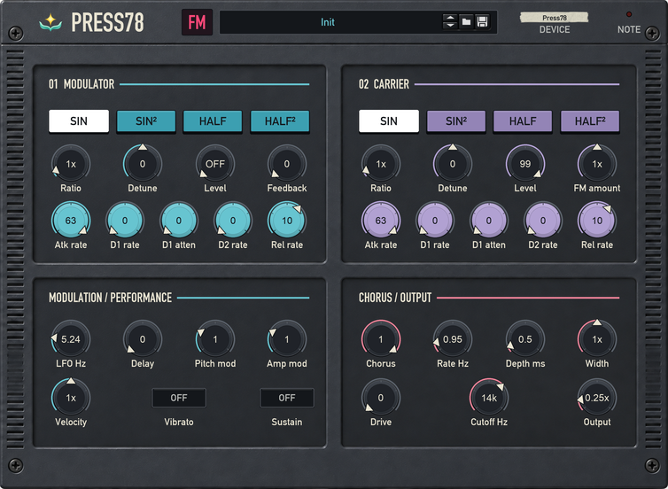
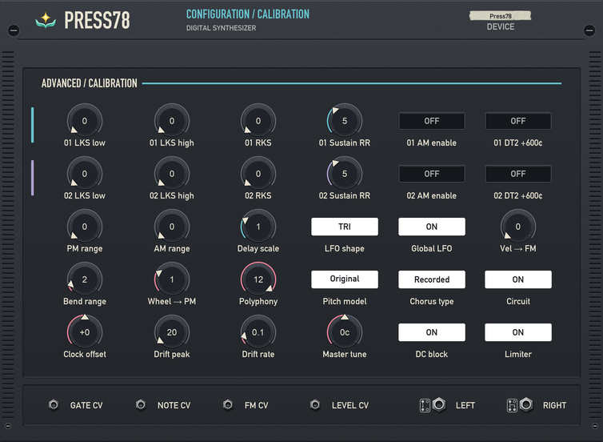
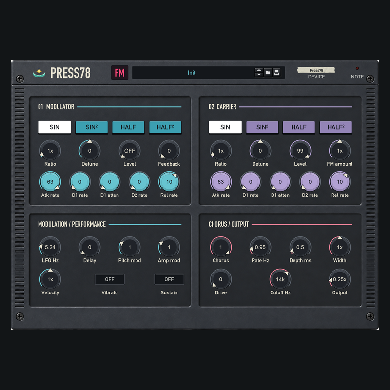

# Tagline

Press78 FM Synth

# Top features

* Two operators with hands-on FM editing
* 100 PSS presets and a Real character profile
* Stereo chorus, circuit colour and four CV inputs

# Intro

Press78 turns the character of a vintage FM keyboard into an editable Reason instrument. Shape two operators, explore 100 PSS presets, and add stereo chorus, circuit colour and gentle clock variation.

# Product desc

Build clear keys, nasal basses, bowed tones and shifting voices from two FM operators. Edit their frequency ratios, waveforms and envelopes, then explore feedback, detuning, velocity response and modulation. Twelve-voice polyphony, pitch bend, modulation and sustain support expressive playing.

The compact 8RU panel combines a charcoal plastic finish with cyan and lavender operator sections. The front keeps the main sound and performance controls within reach. Turn the rack around for detailed operator settings, modulation configuration, circuit choices and fine calibration. Clear position pointers and numeric readouts help make precise edits.

The Real profile starts with Original pitch, modelled output circuitry, Recorded stereo chorus and gentle clock drift. Choose Equal pitch for continuous tuning or switch to the Studio chorus, then shape the result with Tone, Drive and Width. The PSS-inspired engine combines behavioral FM synthesis, a related-hardware output model and a recording-derived chorus, with editable settings throughout.

Browse 100 factory parameter sounds with the PSS prefix through Reason's standard patch browser, or begin with the independent Init patch. Stereo outputs, Note/Gate/FM/Level CV inputs, automation and Remote mapping connect Press78 to the rest of your rack. Press78 is a Rack Extension for Reason 14 or later.

## Version history

### 0.1.0

Initial Rack Extension beta with editable two-operator FM synthesis, 100 PSS factory presets, the Real startup profile and a compact front/rear panel. The current build adds selectable Original pitch behavior and preserves Equal tuning for older documents, alongside corrected patch loading and numeric readouts.

# Images

