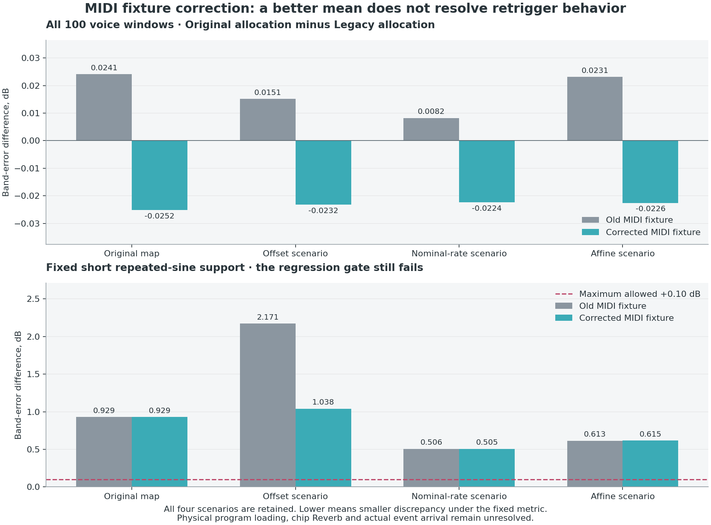

# Corrected MIDI fixture × original allocation

**Correcting the MIDI fixture reverses the all-voice mean band comparison, but the short repeated-sine support still fails its fixed regression limit.** The allocator remains an unadopted research candidate. No production DSP, native wrapper, preset, default, circuit, noise or old result changes in this experiment.

The [protocol](midi-fixture-comparison-protocol-2026-10-19.json) was frozen before compilation/audio and independently reviewed. The [complete ledger](midi-fixture-comparison-2026-10-19.json) preserves all 1,632 score objects and 8,160 contrasts, including unchanged old results. The [earlier failed comparison](hardware-allocation-2026-10-19.md) remains frozen.

## Four cells, one controlled change

Each of four fixed timing scenarios contains Old Legacy, Old Original allocation, Corrected Legacy and Corrected Original allocation. The two Old score sets are exact copies; their retained whole WAVs remain hash-bound. The two Corrected cells use the [independently verified tick/order exports](midi-reference-export-2026-10-19.md), with 1,761 ons, 1,761 offs and 100 unchanged inferred program rows. Note-on times stay unchanged. True note-off ticks and original message order replace separately rounded gates and pitch-sorted chords.

All raw MIDI channels enter one engine owner0 domain in both allocators. The existing C++ reader preserves equal-frame input-line order. A separately compiled unchanged b15 renderer matches every Corrected Legacy whole WAV exactly. Candidate Legacy duplicates are deleted only after that equality; every mismatch would have been retained. Historical channel-owner mapping is not used as the allocator comparator.

All DSP controls, output paths, chorus phase, 32-frame crop, 100 voice windows, two Sine supports, metric source and numerical bounds remain fixed. Old-versus-corrected effects are reported separately under each allocator, alongside the allocation-by-fixture interaction. No timing/gate/phase/EQ/level or physical parameter is fitted.

## Mean results

Values below are Original allocation minus Legacy under each fixture. Negative means smaller discrepancy in the fixed recording windows. These are differences of discrepancy metrics, not measured sound-level changes.

| Timing scenario | Old band Δ, dB | Corrected band Δ, dB | Old STFT-log Δ, dB | Corrected STFT-log Δ, dB |
|---|---:|---:|---:|---:|
| Unchanged | +0.024105 | -0.025182 | +0.021489 | +0.011469 |
| Old scale / median offset | +0.015124 | -0.023212 | +0.023849 | +0.011967 |
| Nominal scale | +0.008222 | -0.022385 | +0.020963 | +0.011920 |
| Robust affine | +0.023091 | -0.022567 | +0.022053 | +0.011460 |

The corrected all-voice band mean improves by about 0.022–0.025 dB relative to corrected Legacy. STFT-log discrepancy still worsens by about 0.0115–0.0120 dB. There are 46/44/41/42 positive all-voice band regressions across the four maps; no epsilon or favorable subset suppresses them.

| Timing scenario | Metadata effect under Legacy, band Δ | Metadata effect under Original, band Δ |
|---|---:|---:|
| Unchanged | +0.003569 | -0.045719 |
| Old scale / median offset | +0.002651 | -0.035685 |
| Nominal scale | +0.004492 | -0.026115 |
| Robust affine | +0.003715 | -0.041944 |

The metadata correction slightly worsens Legacy while reducing Original discrepancy more strongly. Source conformance is independent of audio-score direction: the fixtures are not selected or altered to favor either renderer.

## Focus voices and Sine controls

Corrected Original minus Corrected Legacy, joint stereo band metric:

| Fixed support | Unchanged | Offset | Nominal | Affine |
|---|---:|---:|---:|---:|
| bowed bass | -1.483301 | -1.729896 | -1.732083 | -1.731748 |
| human voice 1 | -0.000014 | -0.000044 | -0.000032 | -0.000040 |
| musical saw | +0.023780 | -0.100302 | -0.074828 | -0.071549 |
| Sine99 full ending | -0.130426 | -0.128191 | -0.098222 | -0.099883 |
| Sine99 prior primary repeated75 | +0.929335 | +1.038203 | +0.504571 | +0.615077 |

Bowed Bass retains its substantial band improvement and improves STFT-log on every map. Human Voice1 remains essentially unchanged, leaving its release/Reverb discrepancy unresolved. Musical Saw is mixed: the unchanged-map band metric worsens slightly, three other maps improve, and STFT-log worsens on **all four** by 0.218–0.235 dB. A band gain alone is not an unqualified timbral improvement.

The full ending Sine support now improves in band error on all four maps. The short repeated75 support still regresses by 0.505–1.038 dB, above its unchanged +0.10 dB ceiling. Every other declared numerical/identity gate passes, including the unchanged-map mean gain requirement; the combined promotion gate remains **failed**. Removing false one-frame overlaps does not resolve the repeated-note envelope/phase/service problem.

The figure is a descriptive view of already frozen reported values, with its source/result hash and all plotted arrays retained locally. It introduces no new support, fit or metric.

## Auditions and independent verification

Twenty local five-part [auditions](/Users/vojta/Dev/virtual-instrument-press78/build/midi-fixture-comparison-v2-20261019/audition.html) present Hardware → Old Legacy → Old Original → Corrected Legacy → Corrected Original. They cover the three focus voices and both Sine supports under every map, with fixed250ms gaps, one RMS gain per stereo model pair, and one common listening safety scalar per support across every map/cell. There is no independent peak normalization or channel gain.

The independent completed-run review passes **34,437 checks**: all 1,632 scores, 816 exact old score copies, 8,160 contrasts, 192 aggregates, gates, regression lists, input/source/WAV identities and all twelve new pressure CSVs. Forty raw metric recalculations have zero difference. All twenty five-part audition WAVs reconstruct byte-exactly. The 28 retained new WAVs total673,134,632bytes, within the prospective800MB ceiling. No synth audio is rerendered by that review.

An initial protocol inherited old timing text without scoping it to Old cells. Review caught that ambiguity before compilation/audio. V2 explicitly separates Old/Corrected timing metadata and adds full postrun dependency checks. Its source snapshots, original protocol and superseded receipt remain retained; events, DSP, scores, windows and gates did not change. The single V2 audio run completed without execution errors.

## Remaining model boundary

All four cells deliberately retain `setPatch(..., false)` future-only voice snapshots to isolate the MIDI fixture. This is not the verified original loader. The [program-load study](opu-mode00-program-load-2026-10-19.md) establishes PSS-780 serial-key clearing/pending cancellation and both models’ all-slot parameter rewrite, while PSS-680 preserves those input states. The [panel caller proof](program-selection-association-2026-10-19.md) extends the path association beyond MIDI C0, without establishing actual video transport or event order.

Reverb and Chorus are visibly on in sampled reference frames. Recorded chorus stays fixed, but the chip-Reverb envelope law is still missing. Original key-service cadence, phase reset, live TL response and measured retrigger envelopes remain unresolved. Actual MIDI delivery, receive masks and program-first/intertrack serialization are conditional. These reused-recording scores therefore neither overturn the earlier failed experiment nor establish hardware truth, Reason performance, complete circuit simulation or market-leading accuracy.

Local media remains in the original research workspace; the audition link above points there explicitly. These third-party recording excerpts and expanded research renders are not redistributed in this repository.
