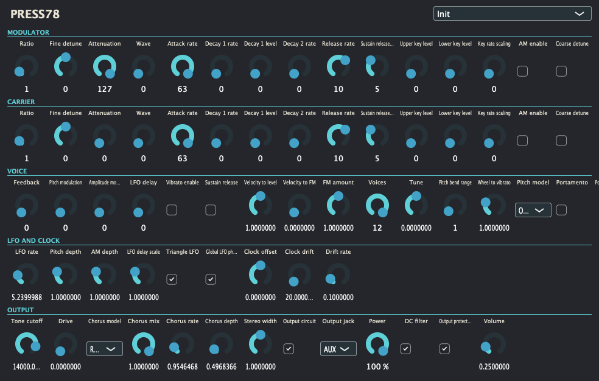

# Press78

Press78 is an editable two-operator FM synthesizer derived from the PSS-780 research experiment, as a VST3, CLAP and Standalone plug-in on macOS, Windows and Linux, plus an Audio Unit on macOS. Its independent C++17 engine also drives an eight-unit Reason Rack Extension prototype. It uses original Press78 branding and focuses on synthesis; it does not reproduce the keyboard, rhythms or accompaniment system. It is a behavioral model, not a bit-exact YM3420 emulator, and commercial redistribution of the imported factory bank has not been cleared.



## Audio demos

One demo per factory voice, rendered by the main build from the phrases in `Docs/audio/midi` through the plug-in's default controls (the Real startup profile, Volume 0.25). Levels are the bank's own; nothing is normalised.

<!-- audio-demos-begin -->

| # | Preset | Demo | Length | Peak |
| --- | --- | --- | --- | --- |
| 1 | PSS 00 Piano 1 | [001-pss-00-piano-1.mp3](Docs/audio/001-pss-00-piano-1.mp3) | 12.9 s | -12.9 dBFS |
| 2 | PSS 01 Piano 2 | [002-pss-01-piano-2.mp3](Docs/audio/002-pss-01-piano-2.mp3) | 12.9 s | -14.8 dBFS |
| 3 | PSS 02 Electric Piano 1 | [003-pss-02-electric-piano-1.mp3](Docs/audio/003-pss-02-electric-piano-1.mp3) | 13.9 s | -10.9 dBFS |
| 4 | PSS 03 Electric Piano 2 | [004-pss-03-electric-piano-2.mp3](Docs/audio/004-pss-03-electric-piano-2.mp3) | 13.9 s | -13.8 dBFS |
| 5 | PSS 04 Honky-Tonk Piano | [005-pss-04-honky-tonk-piano.mp3](Docs/audio/005-pss-04-honky-tonk-piano.mp3) | 11.0 s | -14.3 dBFS |
| 6 | PSS 05 Toy Piano | [006-pss-05-toy-piano.mp3](Docs/audio/006-pss-05-toy-piano.mp3) | 11.4 s | -21.1 dBFS |
| 7 | PSS 06 Reed Organ | [007-pss-06-reed-organ.mp3](Docs/audio/007-pss-06-reed-organ.mp3) | 14.0 s | -9.6 dBFS |
| 8 | PSS 07 Pipe Organ 1 | [008-pss-07-pipe-organ-1.mp3](Docs/audio/008-pss-07-pipe-organ-1.mp3) | 15.9 s | -8.3 dBFS |
| 9 | PSS 08 Pipe Organ 2 | [009-pss-08-pipe-organ-2.mp3](Docs/audio/009-pss-08-pipe-organ-2.mp3) | 15.9 s | -10.7 dBFS |
| 10 | PSS 09 Small Church Organ | [010-pss-09-small-church-organ.mp3](Docs/audio/010-pss-09-small-church-organ.mp3) | 15.9 s | -7.2 dBFS |
| 11 | PSS 10 Electronic Organ | [011-pss-10-electronic-organ.mp3](Docs/audio/011-pss-10-electronic-organ.mp3) | 12.5 s | -6.8 dBFS |
| 12 | PSS 11 Transistor Organ | [012-pss-11-transistor-organ.mp3](Docs/audio/012-pss-11-transistor-organ.mp3) | 11.8 s | -6.3 dBFS |
| 13 | PSS 12 Tremolo Organ | [013-pss-12-tremolo-organ.mp3](Docs/audio/013-pss-12-tremolo-organ.mp3) | 13.4 s | -11.1 dBFS |
| 14 | PSS 13 Jazz Organ | [014-pss-13-jazz-organ.mp3](Docs/audio/014-pss-13-jazz-organ.mp3) | 11.1 s | -12.8 dBFS |
| 15 | PSS 14 Street Organ | [015-pss-14-street-organ.mp3](Docs/audio/015-pss-14-street-organ.mp3) | 11.0 s | -16.4 dBFS |
| 16 | PSS 15 Harpsichord 1 | [016-pss-15-harpsichord-1.mp3](Docs/audio/016-pss-15-harpsichord-1.mp3) | 12.0 s | -15.4 dBFS |
| 17 | PSS 16 Harpsichord 2 | [017-pss-16-harpsichord-2.mp3](Docs/audio/017-pss-16-harpsichord-2.mp3) | 12.9 s | -16.9 dBFS |
| 18 | PSS 17 Funky Clavi | [018-pss-17-funky-clavi.mp3](Docs/audio/018-pss-17-funky-clavi.mp3) | 14.9 s | -19.0 dBFS |
| 19 | PSS 18 Celesta | [019-pss-18-celesta.mp3](Docs/audio/019-pss-18-celesta.mp3) | 13.4 s | -20.0 dBFS |
| 20 | PSS 19 Glass Celesta | [020-pss-19-glass-celesta.mp3](Docs/audio/020-pss-19-glass-celesta.mp3) | 14.4 s | -23.2 dBFS |
| 21 | PSS 20 Accordion | [021-pss-20-accordion.mp3](Docs/audio/021-pss-20-accordion.mp3) | 12.0 s | -17.6 dBFS |
| 22 | PSS 21 Bandoneon | [022-pss-21-bandoneon.mp3](Docs/audio/022-pss-21-bandoneon.mp3) | 13.3 s | -17.8 dBFS |
| 23 | PSS 22 Trumpet | [023-pss-22-trumpet.mp3](Docs/audio/023-pss-22-trumpet.mp3) | 13.9 s | -21.5 dBFS |
| 24 | PSS 23 Mute Trumpet | [024-pss-23-mute-trumpet.mp3](Docs/audio/024-pss-23-mute-trumpet.mp3) | 15.3 s | -27.4 dBFS |
| 25 | PSS 24 Wow Trumpet | [025-pss-24-wow-trumpet.mp3](Docs/audio/025-pss-24-wow-trumpet.mp3) | 15.0 s | -26.0 dBFS |
| 26 | PSS 25 Electric Trumpet | [026-pss-25-electric-trumpet.mp3](Docs/audio/026-pss-25-electric-trumpet.mp3) | 13.1 s | -20.2 dBFS |
| 27 | PSS 26 Horn | [027-pss-26-horn.mp3](Docs/audio/027-pss-26-horn.mp3) | 16.5 s | -21.7 dBFS |
| 28 | PSS 27 Alpenhorn | [028-pss-27-alpenhorn.mp3](Docs/audio/028-pss-27-alpenhorn.mp3) | 17.1 s | -19.7 dBFS |
| 29 | PSS 28 Trombone | [029-pss-28-trombone.mp3](Docs/audio/029-pss-28-trombone.mp3) | 15.3 s | -22.0 dBFS |
| 30 | PSS 29 Tuba | [030-pss-29-tuba.mp3](Docs/audio/030-pss-29-tuba.mp3) | 17.1 s | -16.9 dBFS |
| 31 | PSS 30 Brass Ensemble | [031-pss-30-brass-ensemble.mp3](Docs/audio/031-pss-30-brass-ensemble.mp3) | 14.4 s | -15.2 dBFS |
| 32 | PSS 31 Soprano Sax | [032-pss-31-soprano-sax.mp3](Docs/audio/032-pss-31-soprano-sax.mp3) | 12.4 s | -30.4 dBFS |
| 33 | PSS 32 Alto Sax | [033-pss-32-alto-sax.mp3](Docs/audio/033-pss-32-alto-sax.mp3) | 15.0 s | -19.1 dBFS |
| 34 | PSS 33 Tenor Sax | [034-pss-33-tenor-sax.mp3](Docs/audio/034-pss-33-tenor-sax.mp3) | 15.0 s | -24.1 dBFS |
| 35 | PSS 34 Clarinet | [035-pss-34-clarinet.mp3](Docs/audio/035-pss-34-clarinet.mp3) | 12.4 s | -26.3 dBFS |
| 36 | PSS 35 Bass Clarinet | [036-pss-35-bass-clarinet.mp3](Docs/audio/036-pss-35-bass-clarinet.mp3) | 13.4 s | -20.6 dBFS |
| 37 | PSS 36 Oboe | [037-pss-36-oboe.mp3](Docs/audio/037-pss-36-oboe.mp3) | 12.4 s | -29.1 dBFS |
| 38 | PSS 37 Basson | [038-pss-37-basson.mp3](Docs/audio/038-pss-37-basson.mp3) | 12.9 s | -26.8 dBFS |
| 39 | PSS 38 Piccolo | [039-pss-38-piccolo.mp3](Docs/audio/039-pss-38-piccolo.mp3) | 14.6 s | -31.0 dBFS |
| 40 | PSS 39 Flute | [040-pss-39-flute.mp3](Docs/audio/040-pss-39-flute.mp3) | 12.4 s | -28.0 dBFS |
| 41 | PSS 40 Panflute | [041-pss-40-panflute.mp3](Docs/audio/041-pss-40-panflute.mp3) | 13.9 s | -22.5 dBFS |
| 42 | PSS 41 Recorder | [042-pss-41-recorder.mp3](Docs/audio/042-pss-41-recorder.mp3) | 11.6 s | -28.1 dBFS |
| 43 | PSS 42 Ocarina | [043-pss-42-ocarina.mp3](Docs/audio/043-pss-42-ocarina.mp3) | 13.4 s | -28.2 dBFS |
| 44 | PSS 43 Woodwind Ensemble | [044-pss-43-woodwind-ensemble.mp3](Docs/audio/044-pss-43-woodwind-ensemble.mp3) | 15.5 s | -18.1 dBFS |
| 45 | PSS 44 Bagpipe | [045-pss-44-bagpipe.mp3](Docs/audio/045-pss-44-bagpipe.mp3) | 11.2 s | -27.3 dBFS |
| 46 | PSS 45 Harmonica | [046-pss-45-harmonica.mp3](Docs/audio/046-pss-45-harmonica.mp3) | 15.0 s | -23.9 dBFS |
| 47 | PSS 46 Jug | [047-pss-46-jug.mp3](Docs/audio/047-pss-46-jug.mp3) | 12.8 s | -17.8 dBFS |
| 48 | PSS 47 Kazoo | [048-pss-47-kazoo.mp3](Docs/audio/048-pss-47-kazoo.mp3) | 15.7 s | -26.4 dBFS |
| 49 | PSS 48 Samba Whistle | [049-pss-48-samba-whistle.mp3](Docs/audio/049-pss-48-samba-whistle.mp3) | 13.4 s | -28.6 dBFS |
| 50 | PSS 49 Acoustic Guitar | [050-pss-49-acoustic-guitar.mp3](Docs/audio/050-pss-49-acoustic-guitar.mp3) | 15.0 s | -7.6 dBFS |
| 51 | PSS 50 Classic Guitar | [051-pss-50-classic-guitar.mp3](Docs/audio/051-pss-50-classic-guitar.mp3) | 18.0 s | -11.1 dBFS |
| 52 | PSS 51 Hawaiian Guitar | [052-pss-51-hawaiian-guitar.mp3](Docs/audio/052-pss-51-hawaiian-guitar.mp3) | 12.1 s | -19.2 dBFS |
| 53 | PSS 52 Jazz Guitar | [053-pss-52-jazz-guitar.mp3](Docs/audio/053-pss-52-jazz-guitar.mp3) | 11.5 s | -11.3 dBFS |
| 54 | PSS 53 Rock Guitar 1 | [054-pss-53-rock-guitar-1.mp3](Docs/audio/054-pss-53-rock-guitar-1.mp3) | 12.7 s | -26.4 dBFS |
| 55 | PSS 54 Rock Guitar 2 | [055-pss-54-rock-guitar-2.mp3](Docs/audio/055-pss-54-rock-guitar-2.mp3) | 11.6 s | -18.2 dBFS |
| 56 | PSS 55 Rock Guitar 3 | [056-pss-55-rock-guitar-3.mp3](Docs/audio/056-pss-55-rock-guitar-3.mp3) | 13.1 s | -22.5 dBFS |
| 57 | PSS 56 Pedal Steel Guitar | [057-pss-56-pedal-steel-guitar.mp3](Docs/audio/057-pss-56-pedal-steel-guitar.mp3) | 12.4 s | -24.7 dBFS |
| 58 | PSS 57 Tremolo Guitar | [058-pss-57-tremolo-guitar.mp3](Docs/audio/058-pss-57-tremolo-guitar.mp3) | 16.8 s | -12.3 dBFS |
| 59 | PSS 58 12String Guitar | [059-pss-58-12string-guitar.mp3](Docs/audio/059-pss-58-12string-guitar.mp3) | 14.0 s | -12.7 dBFS |
| 60 | PSS 59 Electric Bass | [060-pss-59-electric-bass.mp3](Docs/audio/060-pss-59-electric-bass.mp3) | 12.0 s | -14.8 dBFS |
| 61 | PSS 60 Mute Bass | [061-pss-60-mute-bass.mp3](Docs/audio/061-pss-60-mute-bass.mp3) | 12.8 s | -14.2 dBFS |
| 62 | PSS 61 Picked Bass | [062-pss-61-picked-bass.mp3](Docs/audio/062-pss-61-picked-bass.mp3) | 11.3 s | -16.4 dBFS |
| 63 | PSS 62 Slap Bass | [063-pss-62-slap-bass.mp3](Docs/audio/063-pss-62-slap-bass.mp3) | 13.0 s | -23.1 dBFS |
| 64 | PSS 63 Wood Bass 1 | [064-pss-63-wood-bass-1.mp3](Docs/audio/064-pss-63-wood-bass-1.mp3) | 13.2 s | -15.1 dBFS |
| 65 | PSS 64 Wood Bass 2 | [065-pss-64-wood-bass-2.mp3](Docs/audio/065-pss-64-wood-bass-2.mp3) | 12.3 s | -13.2 dBFS |
| 66 | PSS 65 Bowed Bass | [066-pss-65-bowed-bass.mp3](Docs/audio/066-pss-65-bowed-bass.mp3) | 14.5 s | -17.8 dBFS |
| 67 | PSS 66 Banjo | [067-pss-66-banjo.mp3](Docs/audio/067-pss-66-banjo.mp3) | 15.6 s | -18.0 dBFS |
| 68 | PSS 67 Ukulele | [068-pss-67-ukulele.mp3](Docs/audio/068-pss-67-ukulele.mp3) | 13.2 s | -10.8 dBFS |
| 69 | PSS 68 Mandolin | [069-pss-68-mandolin.mp3](Docs/audio/069-pss-68-mandolin.mp3) | 12.7 s | -12.9 dBFS |
| 70 | PSS 69 Harp | [070-pss-69-harp.mp3](Docs/audio/070-pss-69-harp.mp3) | 13.0 s | -10.7 dBFS |
| 71 | PSS 70 Sitar | [071-pss-70-sitar.mp3](Docs/audio/071-pss-70-sitar.mp3) | 12.1 s | -24.8 dBFS |
| 72 | PSS 71 Shamisen | [072-pss-71-shamisen.mp3](Docs/audio/072-pss-71-shamisen.mp3) | 10.9 s | -19.1 dBFS |
| 73 | PSS 72 Jamisen | [073-pss-72-jamisen.mp3](Docs/audio/073-pss-72-jamisen.mp3) | 11.5 s | -22.1 dBFS |
| 74 | PSS 73 Koto | [074-pss-73-koto.mp3](Docs/audio/074-pss-73-koto.mp3) | 12.8 s | -18.9 dBFS |
| 75 | PSS 74 Violin 1 | [075-pss-74-violin-1.mp3](Docs/audio/075-pss-74-violin-1.mp3) | 12.5 s | -26.6 dBFS |
| 76 | PSS 75 Violin 2 | [076-pss-75-violin-2.mp3](Docs/audio/076-pss-75-violin-2.mp3) | 11.5 s | -26.5 dBFS |
| 77 | PSS 76 Cello | [077-pss-76-cello.mp3](Docs/audio/077-pss-76-cello.mp3) | 13.4 s | -19.5 dBFS |
| 78 | PSS 77 Strings | [078-pss-77-strings.mp3](Docs/audio/078-pss-77-strings.mp3) | 14.2 s | -13.1 dBFS |
| 79 | PSS 78 Synth Brass | [079-pss-78-synth-brass.mp3](Docs/audio/079-pss-78-synth-brass.mp3) | 13.9 s | -18.1 dBFS |
| 80 | PSS 79 Synth Bass | [080-pss-79-synth-bass.mp3](Docs/audio/080-pss-79-synth-bass.mp3) | 10.5 s | -22.4 dBFS |
| 81 | PSS 80 Synth Tom | [081-pss-80-synth-tom.mp3](Docs/audio/081-pss-80-synth-tom.mp3) | 12.9 s | -16.1 dBFS |
| 82 | PSS 81 Carillon | [082-pss-81-carillon.mp3](Docs/audio/082-pss-81-carillon.mp3) | 17.1 s | -22.9 dBFS |
| 83 | PSS 82 Chimes | [083-pss-82-chimes.mp3](Docs/audio/083-pss-82-chimes.mp3) | 17.1 s | -23.0 dBFS |
| 84 | PSS 83 Hand Bell | [084-pss-83-hand-bell.mp3](Docs/audio/084-pss-83-hand-bell.mp3) | 15.6 s | -28.6 dBFS |
| 85 | PSS 84 Tubular Bells | [085-pss-84-tubular-bells.mp3](Docs/audio/085-pss-84-tubular-bells.mp3) | 18.4 s | -25.7 dBFS |
| 86 | PSS 85 Timpani | [086-pss-85-timpani.mp3](Docs/audio/086-pss-85-timpani.mp3) | 14.8 s | -10.1 dBFS |
| 87 | PSS 86 Steel Drum 1 | [087-pss-86-steel-drum-1.mp3](Docs/audio/087-pss-86-steel-drum-1.mp3) | 13.3 s | -22.5 dBFS |
| 88 | PSS 87 Steel Drum 2 | [088-pss-87-steel-drum-2.mp3](Docs/audio/088-pss-87-steel-drum-2.mp3) | 12.5 s | -16.7 dBFS |
| 89 | PSS 88 Glockenspiel | [089-pss-88-glockenspiel.mp3](Docs/audio/089-pss-88-glockenspiel.mp3) | 14.6 s | -19.7 dBFS |
| 90 | PSS 89 Marimba 1 | [090-pss-89-marimba-1.mp3](Docs/audio/090-pss-89-marimba-1.mp3) | 14.6 s | -8.3 dBFS |
| 91 | PSS 90 Marimba 2 | [091-pss-90-marimba-2.mp3](Docs/audio/091-pss-90-marimba-2.mp3) | 15.8 s | -9.4 dBFS |
| 92 | PSS 91 Vibraphone | [092-pss-91-vibraphone.mp3](Docs/audio/092-pss-91-vibraphone.mp3) | 11.9 s | -14.3 dBFS |
| 93 | PSS 92 Human Chorus | [093-pss-92-human-chorus.mp3](Docs/audio/093-pss-92-human-chorus.mp3) | 13.5 s | -14.9 dBFS |
| 94 | PSS 93 Human Voice 1 | [094-pss-93-human-voice-1.mp3](Docs/audio/094-pss-93-human-voice-1.mp3) | 15.5 s | -26.4 dBFS |
| 95 | PSS 94 Human Voice 2 | [095-pss-94-human-voice-2.mp3](Docs/audio/095-pss-94-human-voice-2.mp3) | 16.6 s | -28.4 dBFS |
| 96 | PSS 95 Whistle | [096-pss-95-whistle.mp3](Docs/audio/096-pss-95-whistle.mp3) | 16.2 s | -22.1 dBFS |
| 97 | PSS 96 Ice Block | [097-pss-96-ice-block.mp3](Docs/audio/097-pss-96-ice-block.mp3) | 12.7 s | -26.8 dBFS |
| 98 | PSS 97 Musical Saw | [098-pss-97-musical-saw.mp3](Docs/audio/098-pss-97-musical-saw.mp3) | 12.4 s | -24.4 dBFS |
| 99 | PSS 98 Music Box | [099-pss-98-music-box.mp3](Docs/audio/099-pss-98-music-box.mp3) | 11.6 s | -28.6 dBFS |
| 100 | PSS 99 Sine Wave | [100-pss-99-sine-wave.mp3](Docs/audio/100-pss-99-sine-wave.mp3) | 11.1 s | -17.8 dBFS |

<!-- audio-demos-end -->

## Version history

### Unreleased — 0.1.9 — PSS-780 firmware laws, chip rate, analog chorus and amplifier

- 0.1.9: New instances, Init, the 100 `PSS` patches and the modern presets run the FM chip at the YM3420's own sample rate, 57,291.67 Hz, instead of 48 kHz. Bright high notes fold their top partials back to the hardware's inharmonic pitches: C7's sit at 785.0 and 1307.8 Hz, within 0.2 Hz of PSS-680 recordings, where 48 kHz put them at 135 and 1958 Hz. Across the `PSS` voices at C6, G6 and C7, 26 of 300 notes carry such lines above −60 dB, Bagpipe's C7 the strongest at −39 dB. Lower notes, timing and latency are unchanged; twelve FM voices take about a quarter more CPU at 48 kHz. Older songs that lack the setting keep 48 kHz.
- 0.1.8: Adds an **Output jack** choice. New instances, Init, the 100 `PSS` patches and the modern presets play from **AUX**, through the power amplifier as the PSS-480 builds it: bass is 1 dB lower at 80 Hz and 4 dB lower at 33 Hz, and treble 1 dB lower at 10 kHz and 2 dB lower at 15 to 20 kHz. **Phones** passes the headphone jack's network instead, with a 32 Ω headphone, which takes about 2 dB off the centre of a 65 Hz bass note and lets low bass leak between the earpieces. **Preamp** keeps the earlier output, and older songs that lack the setting use it.
- 0.1.7: New instances, Init, the 100 `PSS` patches and the modern presets pass the Recorded chorus's delayed signal through the bucket-brigade chorus's analog filters, with values borrowed from the PSS-270 schematic. The chorus shimmer loses its fizz: the stereo difference signal is about 12 dB lower from 5 to 8 kHz and about 2 dB higher from 1.5 to 3 kHz, and each channel changes by 1 to 2 dB in those bands. Studio chorus and patches without chorus are unchanged. Older songs that lack the setting keep the unfiltered delay.
- 0.1.6: New instances, Init, the 100 `PSS` patches and the modern presets allocate voices as the PSS-780 does in its normal keyboard mode. Replaying a note cuts that note's own release instead of stacking a second copy on it, so fast repeats on long-release sounds no longer build up or phase; a held key sent again is ignored; and a new note takes a released voice before stealing a held one. Older songs that lack the setting keep the previous free-voice-then-oldest policy.
- 0.1.5: New instances, Init, the 100 `PSS` patches and the modern presets scale each operator's level across the keyboard with the PSS-780 program's own per-key tables. Most patches change by under 1 dB; Human Chorus, Human Voice 1, Strings and Soprano Sax are up to 4.3 dB different at the ends of the keyboard, and modulator changes of up to 5.8 dB alter brightness from low to high notes. Older songs that lack the setting keep the earlier curves.
- 0.1.4: New instances, Init, the 100 `PSS` patches and the modern presets follow the PSS-780's own MIDI velocity curve: soft notes are louder than before (velocity 16 sits 15.75 dB below full instead of 18 dB, velocity 1 at 23.25 dB instead of 42 dB), and velocities from 32 up change by under 1 dB. Older songs that lack the setting keep the linear curve.
- 0.1.3: Adds the PSS-780's **Portamento** effect with its five speeds (1 slow … 5 fast, default 3), switchable from the panel or MIDI CC65. Each new note glides from the previous note in a fixed time per speed, whatever the interval, as the keyboard's own program does. The glide's absolute timing is an estimate.
- 0.1.2: New instances, Init and the 100 `PSS` patches start with a ±1 semitone pitch wheel, the PSS-780's own reset value (owner's manual, printed pp. 10 and 39). Older songs that lack the setting keep ±2, and the modern presets keep their own ranges.
- 0.1.1: Applies the selected B listening options: a longer envelope-Reverb tail and shared asymmetric output headroom, enabled by default. No artificial noise is added. Existing patches acquire the selected character when their models are enabled. The values are chosen assumptions, not recovered PSS-780 calibration. See the [decision](Docs/decisions.md) and [adoption note](Docs/release/assumed-hardware-adoption-2026-10-19.md).

### 0.1.0 — engine, Rack prototype and plug-in front end

- Two-operator FM engine with the 100 `PSS` factory voices and an Init sine, sibling-circuit output stage, Studio and Recorded chorus, and clock variation.
- b11: the D1 endpoint correction and a 5.24 Hz triangle LFO with recording-supported vibrato depths; additive noise removed (its two controls stay as inert, hidden ids).
- b12: a **Pitch model** selector, Original (the firmware pitch-command table, the new default) or Equal (the earlier continuous law).
- b13: the Original release-pedal policy (the pedal selects the release rate; key-up releases at once), a hidden setting that new patches turn on.
- b14: a fixed output bus and final converter keep the 48 kHz output character at every host rate; other rates change audio and latency.
- b15: 50 modern Rack presets (basses, donks, plucks, leads, pads and FX) beside the 100 `PSS` voices; the plug-in does not include them yet.
- b16: new Reason devices open **BASS - Vowel Engine**, a velocity-responsive low-register growl. Init remains available in the patch browser; saved sounds and the JUCE plug-in's startup are unchanged.
- Reason Rack Extension prototype 0.1.0b16, built outside this repository.
- First JUCE plug-in: every control as a parameter, Init plus the 100 voices as programs, and a working editor; the Rack panel design is not yet ported to it.

## Downloads

<!-- build-download-begin -->
<!-- build-download-end -->

---

## How it works

### Engine

Both operators expose ratio, fine/coarse detune, four waveform families, raw envelope rates, key scaling and AM. Additional controls cover feedback, velocity, LFO phase/depth/delay, twelve-voice allocation, pitch bend, mod wheel, clock variation, analog output, tone, drive, chorus and stereo width. The Rack adapter adds separate MIDI/CV note ownership and Note/Gate/FM/Level CV inputs. All 67 visible controls have explicit Reason automation mappings. The two former noise properties and their IDs remain reserved for compatibility; they are hidden and inert. The registry stays frozen in `Assets/rack-automation.json`; Volume/Tone retain MIDI CC7/74.

The initial port preserved the frozen Python raw-FM behavior. Starting with b11, a documented D1 endpoint correction and recording-supported modulation replace those corresponding hypotheses; the Python files remain frozen historical references. It adds fixed-storage voice management, short voice-stealing tails, continuous-control smoothing and host-rate conversion. The floating-point operators, envelope laws and detune mappings are modeling choices, not recovered chip internals; so is the legacy 48 kHz timebase, which the YM3420 rate below replaces. The core has 0.67 ms (32 legacy samples) of nominal reconstruction latency at either rate. The b14 instrument adds a final host converter outside 48k; its declared Rack latency is 126/32/236/256/512 frames at 44.1/48/88.2/96/192k. Clock controls also scale that physical delay; upward clock shifts can alias near-Nyquist energy. Clock drift is a controllable scenario, not a measurement of aged hardware. Memory faults and random digital bit corruption are not introduced as normal vintage behavior.

The b12 rear **Pitch model** selector offers **Original** and **Equal**. New Init/PSS patches explicitly select Original; older patches missing the new property retain Equal. Original uses the independently reconstructed 384-word firmware pitch-command table, including its nonmonotonic A-flat fractional entry and high-seven-bit MIDI bend behavior. Device Tune rounds to 3.125-cent steps; host master tuning and internal vibrato stay continuous. The downstream command-to-frequency floor/grid remains a recording-supported behavioral hypothesis, not identified silicon arithmetic. Extended keyboard/tuning ranges are plugin extensions. The selector displays the requested model; changes wait until held notes, releases and steal fades finish, or reset/all-sound-off. [Firmware evidence](Docs/research/opu-pitch-command-path-2026-10-19.md), [physical panel mapping](Docs/research/front-panel-envelope-map-2026-10-19.md) and [frozen comparison](Docs/research/hardware-pitch-b12-2026-10-19.md) separate verified commands from inferred synthesis behavior.

The b11 modulation profile uses a continuous 5.24 Hz triangle and a binary PMS depth hypothesis: 0,3.125,6.25,12.5,25,50,100,200 cents. The original PSS-780 recording directly supports roughly 12.5 cents at PMS3 and 100 cents at PMS6; unobserved levels remain a modeled interpolation. New PSS-580 recordings independently corroborate the approximately 5.24–5.25Hz triangle motion, with raw patch-depth and global-phase qualifications. The existing 10 ms/VDT delay law remains uncertain. D1 now tests whether its endpoint is already reached before applying a decay increment, eliminating unwanted attenuation from a zero-height stage. See the [FM audit](Docs/research/fm-fidelity-audit-2026-10-18.md), [pitch audit](Docs/research/lfo-pitch-audit-2026-10-18.md) and [independent recordings](Docs/research/recording-holdout-audit-2026-10-18.md).

### Chip sample rate

The YM3420 runs at the PSS-780's 5.5 MHz OPU clock divided by 96, 57,291.67 Hz (`Press78Engine::kYm3420Rate`). The divider is measured, not documented: in PSS-680 recordings (the same chip) 205 alias lines across 63 notes fit 96 × fs = 5.4992 MHz, within 150 ppm of that clock, where dividers of 95 or 97 would need a 1 % clock error. At that rate the firmware's pitch words are the chip's 20-bit phase step per sample. The FM operators are not band-limited, on the chip or here, so partials above 28.6 kHz fold back to inharmonic lines; C7's f0 is almost exactly 8/219 of the rate, which puts them on the odd multiples of f0/8 that recordings of C7 show. A 48 kHz core folds them elsewhere. Pitch, envelopes, LFOs, smoothing, portamento and steal fades are laws in seconds, so notes whose partials stay below the fold sound as before; the host converter's delay is held at 32/48000 s so latency does not change. **Chip sample rate** is a hidden compatibility setting: YM3420 for new instances and the factory patches, Legacy (48 kHz) for older songs. A change waits until voices are idle, like the other firmware laws.

### Output circuit

The enabled-by-default output circuit combines the selected shared asymmetric headroom curve with the six-section small-signal transfer from the researched **PSS-480** circuit. The curve's normalized headroom of 1 and bias of 0.14 were selected through the B audition; the filter is a sibling surrogate. Neither is a recovered PSS-780 board, verified YM3420 DAC transfer or transistor-level model. The existing output-circuit switch bypasses both together. Drive remains a separate creative saturation control.

Authentic DAC behavior, component tolerances and power sensitivity remain fidelity requirements despite removal of artificial noise. The selected output curve supplies deterministic signal-dependent color; its constants do not establish physical operating levels. A [research supply component](Docs/research/local-supply-model-2026-10-19.md) implements the documented sibling local rail filter with independent circuit checks. Its load and voltage-to-audio coupling remain unknown and are not connected to the audio engine.

B14 preserves the established 48k output character across host rates through a fixed output bus and a final stereo converter. It intentionally changes non-48k audio and latency in existing documents; all 48k renders remain unchanged. [Adoption and A/B evidence](Docs/research/output-bus-b14-2026-10-19.md) separates improved host-rate consistency from still-unidentified DAC, BBD nonlinear and voltage-to-audio behavior.

### Amplifier and output jacks

**Output jack** chooses which socket is heard (`Source/DSP/AmplifierCircuit.h`). **Preamp** is the signal at the top of the volume slider, where the output circuit above ends. **AUX** and **Phones** add the power amplifier after the slider. The PSS-780 lists the same AN7148 amplifier, 1000 µF/16 V output capacitors, 4 Ω speakers and 3.3 µH headphone coils as the PSS-480, so the values come from the PSS-480 drawing (KEC-11861) and the AN7148 datasheet and are borrowed. The slider's wiper drives 10 kΩ into 1 kΩ ‖ 4700 pF, a pole at 37.25 kHz. The datasheet's gain curve, −1 dB at 15 kHz, is read as one pole at 29.48 kHz; both poles together lose 0.8 dB at 10 kHz and 1.7 dB at 15 kHz. They sit near or above the engine's 24 kHz Nyquist frequency, so one first-order section matches their combined level at DC, 15 kHz and Nyquist, within 0.4 dB from 1 to 20 kHz.

AUX OUT is taken from the speaker node, after the output capacitor, as the PSS-270 and PSS-560 take it; the PSS-780's own AUX network is not documented. 1000 µF into the 4 Ω speaker is a 39.8 Hz high-pass, which also accounts for the low end of the datasheet's curve (−1 dB at 80 Hz, −3.7 dB at 33 Hz). The speaker is taken as a plain 4 Ω, the datasheet's load; a real driver's impedance rises towards its resonance and would soften this, but its curve is not known. **Phones** follows the PSS-480 headphone jack: 100 Ω in series, and a sleeve that returns to ground through one 47 µF shared by both earpieces, with the speakers cut (PSS-780 owner's manual, p. 8). With a 32 Ω headphone, an assumed load, the shared capacitor puts a 52.5 Hz high-pass on the centre (mid) signal only, so bass on one side leaks into the other: −6.7 dB at 50 Hz. Higher-impedance headphones lower that corner (about 17 Hz at 300 Ω). Each path is set to unity gain in its passband, so **Volume** still sets the level; the hardware's absolute levels and the amplifier's clipping are not modelled.


### Portamento

The glide follows the PSS-780 program (`xg503b0-132`, read 2026-10-20; nothing from it is included). A note-on glides from the most recent note-on, held or released, when Portamento is on; the first note after reset does not glide. Its slot starts at the previous pitch and moves linearly in 1/256-semitone steps of `interval × 2^speed` per pass of the program's main loop, heard as 1/32-semitone pitch commands, until it reaches the new note. Every glide therefore takes `2^(8 − speed)` passes: 128, 64, 32, 16 and 8 for speeds 1–5. Chords glide note by note from the note played just before. The main loop is not paced by a timer and was not measured; Press78 assumes 2.5 ms per pass, giving 320/160/80/40/20 ms. CC65 values of 64 and above switch it on and lower values off, overriding the panel control until Reset All Controllers.

### Velocity

With the Original velocity curve, a note's carrier level follows the table the PSS-780 program (`xg503b0-132`, bank 2 `$7890`) applies in its MIDI sound-source mode (Mode 99): a carrier attenuation of 31 TL codes below velocity 3, falling by one code at each of velocities 3, 4, 5, 6, 7, 9, 10, 12, 13, 15, 17, 19, 22, 24, 27, 30, 34, 37, 41, 46, 51, 56, 62, 68, 74, 80, 87, 94, 102, 111 and 118, where it reaches zero. A TL code is taken as 0.75 dB, the engine's existing TL law. **Velocity to level** scales that attenuation in dB, so 1 is the hardware's curve and 0 is the keyboard mode (Mode 00), which ignores velocity. **Velocity to FM** is Press78's own and keeps its linear law. The firmware's saturation of TL plus addend at 127 is more than 95 dB down and is not modelled. The hidden **Original velocity curve** setting keeps the linear `(velocity/127)^sensitivity` law for older songs.

### Key scaling

With Original key scaling, each operator's level follows the per-key TL offsets the PSS-780 program adds before it sends a level to the sound chip. Its 16 lower and 16 upper tables, chosen by the patch's low and high key-level settings, give a signed offset per pair of keys: lower tables run from key 24 up to middle C, where every table is zero, and upper tables from middle C to key 102, holding their end values beyond. The sum saturates at 0 and 127, so a negative offset never lifts an operator above full level, and the result mutes the operator at 99 and above, as a raw TL of 99 does. The tables (`Source/DSP/FirmwareLevel.h`, from `Tools/generate_firmware_level.py`) are re-expressed from the program's results; no ROM bytes or code are included. A code is taken as 0.75 dB, the engine's existing TL law. The [b13 comparison](Docs/research/hardware-key-level-b13-2026-10-19.md) against an old recording failed its adoption gate on Bowed Bass by about 0.2 dB while improving the 100-patch average; the owner chose to ship the keyboard's own tables regardless. The hidden **Original key scaling** setting keeps the earlier fitted curves for older songs, and a change waits until held notes, releases and steal fades finish.

### Voice allocation

With Original voice allocation, notes follow the PSS-780 program's Mode 00 allocator (`Source/DSP/FirmwareAllocation.h`, re-expressed from the [recovered command path](Docs/research/opu-allocation-command-path-2026-10-19.md); no ROM bytes or code are included). A note-on for a key already held does nothing. A new key first reuses the slot that last played the same note, held or released, ending its old sound with the engine's short steal fade. Otherwise it takes the slot with the lowest saturating 8-bit rank: a held key is ranked 255 and a released one 127, and every key event ages the others by one, so released voices are always taken before held ones and the oldest within each class goes first. Reduced polyphony uses the first N slots. MIDI and CV are two separate key sources sharing the pool, a Press78 extension. When the chip's key-on resets oscillator phase and how fast the program services keys are not known; Press78 keys the slot immediately and keeps the oscillator and envelope laws it already had. The [recording comparison](Docs/research/hardware-allocation-2026-10-19.md) failed its adoption gate on a short sine passage while greatly improving Bowed Bass; the owner chose to ship the keyboard's own allocation. The hidden **Original voice allocation** setting keeps the earlier policy for older songs, and a change waits until every key is up and voices, releases and steal fades have finished.

### Sustain pedal

B13 adds the [Original release-pedal policy](Docs/research/sustain-policy-2026-10-19.md): the pedal selects RR/SRR while keyoff releases immediately, including live rate updates on released notes. New Init/PSS files select it; older documents retain conventional pedal holding. The hidden compatibility setting leaves the panel unchanged. All eight no-pedal full-performance WAVs match b12 exactly, so existing recording scores are unchanged. The authored Sustain button does not display the temporary pedal override, and the plugin does not emulate complete keyboard program-change behavior.

### Chorus

Two realtime chorus modes are available. **Studio** preserves the original creative delay effect. **Recorded** implements the frozen v3 effective stereo transfer from the PSS-780 recording: roughly 0.49–1.51 ms delay, a continuous 0.954647 Hz LFO, second-harmonic motion and direct mid leakage. It adds no whole-output latency. The rate and depth remain editable. This is a recording-derived approximation, not an identified MN3206 circuit. The offline v4 branch correction remains a reference because an exact causal port would need about 21.83 ms lookahead compensation at 48 kHz.

With the PSS-270 chorus circuit (`Source/DSP/ChorusCircuit.h`), Recorded mode's delayed signal also passes the BBD's analog wet path, with values read from the PSS-270 schematic (KEC-11463). The PSS-780 uses the same MN3206/MN3102 pair and carries the PSS-270's clock and inverter parts, but its own filter values are not documented, so these are borrowed. Before the delay, a 0.1 µF / 1.5 kΩ / 33 nF network into the 50 kΩ bias puts poles at 23.5 Hz and 4.35 kHz. After it, a 0.1 µF coupling into 50 kΩ feeds a unity-gain Sallen-Key low-pass (22 kΩ + 22 kΩ, 12 nF, 680 pF; 2.53 kHz, Q 2.1). Together they give −1.6 dB at 100 Hz, +4.1 dB at 2.39 kHz, −8.2 dB at 4 kHz and −19 dB at 6 kHz relative to 1 kHz. The right channel's inverted copy also passes the inverter's 47 kΩ / 220 pF pole at 15.4 kHz. Two conventions, not circuit values, keep the recorded fit intact: the filters are normalised to unity at 1 kHz, where the fit's wet gain was identified, and their 0.092 ms group delay at 1 kHz comes off the recorded delay. The pre-delay filter runs after the delay read; at the recorded depth the delay's motion shifts pitch by at most 0.4 %, so the order is inaudible. The hidden **Chorus wet-path circuit** setting keeps the unfiltered delay for older songs.

### Noise

The standalone PSS-480 resistor/opamp noise model and earlier noise research remain as historical reference tools. They are not connected to the instrument engine; no additive PRNG, circuit-noise generator or noise controls remain in the unit. The [b11 audit](Tests/results/noise-removal-b11-audit.json) preserves the initial verification; the [b12 noise-removal audit](Tests/results/noise-removal-b12-audit.json) verifies current source, source-bound normal/sanitized wrapper tests, absent GUI controls and all 101 packaged patches.

### Startup profile and factory bank

The Rack Init and all 100 factory patches use the **Real** startup profile: related-hardware output circuit on, Recorded chorus at its captured rate/depth and full reference side level, and a slow ±20 ppm clock excursion at 0.1 Hz (about ±0.035 cents). Clock offset and creative Drive stay zero. Clock excursion is an explicit modeling choice, not recovered PSS-780 calibration. Additive noise has been removed from the runtime, including both White and Circuit paths. Old patches and automation may still contain the former noise properties; their values are ignored and cannot restore hiss. Other values remain editable and persist with patches. The portable constructor also uses the new 5.24 Hz shared triangle LFO; its effect defaults remain independent of the Rack Real profile. Model selectors and fine calibration are on the rear.

New Reason devices open **BASS - Vowel Engine**, the existing modern preset selected by `Assets/FactoryBank/rack-startup.json`. Play MIDI notes 30–54 for its throaty, rhythmic growl; velocity adds bite and the wheel adds slow pitch wobble. Its sound parameters are unchanged. Init remains an independently defined sine patch in the standard patch browser. This Rack startup selection does not change saved patches, compatibility defaults or the JUCE plug-in's Init startup.

The public development bank contains the 100 original parameter presets as `PSS 00 …` through `PSS 99 …`. The Rack bank also carries 50 modern presets (12 basses, 8 donks, 12 plucks, 8 leads, 6 pads and 4 FX) under `Modern`, defined in `Assets/FactoryBank/modern-*.json`; the [factory presets guide](Docs/guide/factory-presets.md) lists them, and [the modern audition page](Docs/guide/modern-presets.html) plays each one. Loading/editing a Rack patch retimbres held voices while preserving their oscillator/envelope state. The standalone engine also offers future-voices-only program snapshots.

### Plug-in front end

The plug-in's parameter IDs are the control ids in `Assets/controls.json`, the same names as the Rack properties; `Source/PluginControls.h` is generated from that file by `Tools/generate_plugin_controls.py`. `Source/ControlMapping.h` maps the controls to the engine's patch and controls for both the plug-in and the demo renderer. Program 0 is Init and programs 1–100 are the factory voices; a program change sets the 36 sound controls and leaves performance and output controls, including Pitch model, alone, and editing a sound control retimbres held voices, as the Rack does. Pitch bend scales by Pitch bend range, which starts at ±1 semitone as on the PSS-780 after ALL RESET, and Original receives the raw 14-bit wheel as the firmware does; the mod wheel adds its position times Wheel to vibrato to Pitch depth (this mapping is the plug-in's own choice; the Rack adapter's is not in this repository). A new instance starts with Pitch model and the Original release policy on, as the Rack Init does, and CC64 reaches the engine as its raw value because Original treats any nonzero value as down. The release policy and the two inert noise ids stay as parameters so saved sessions load, but like the Rack panel the editor omits them. The programs are Init and the 100 `PSS` voices; the 50 modern presets are Rack patches only for now. The editor is a working one-control-per-parameter layout; the designed Rack panel below is not yet ported to it.

### Panel design

Open [the interactive design preview](Assets/Design/index.html). Layout study 11 uses an eight-rack-unit panel with consistent section padding and puts 34 main sound/performance controls on the front, with 30 detailed sound, calibration and configuration controls on the rear. It combines the canonical Protocodus logo, YouKnow's DIN lettering and recessed groups with charcoal ABS, cyan, lavender, coral and ivory inspired by the PSS-780 moodboard. Doubled pointer arrows remain clear of the knob number wells. The preview has editable operator controls, all 100 PSS originals and 50 modern sounds. It demonstrates layout and parameter relationships, without audio. [Design notes](Assets/Design/README.md) describe the front, rear and folded panels. Both native GUI asset sets and the native local/universal builds carry this styling. Level increases clockwise while preserving the original raw attenuation values; clearer envelope/unit labels and value arcs improve editing. The current layout follows the photographic recesses, shares vertical centres within each row and aligns the header controls.

### Repository layout

| Path | Purpose |
| --- | --- |
| `Source/DSP` | Fixed-storage polyphonic engine and generated circuit/preset tables (JUCE-free, C++17) |
| `Source/Plugin*`, `Source/ControlMapping.h` | JUCE plug-in front end and its control mapping |
| `Assets/controls.json` | Parameter contract shared with the Rack adapter: 64 controls, two inert legacy noise properties and the hidden release policy |
| `Assets/rack-automation.json` | Frozen Reason automation IDs |
| `Assets/FactoryBank` | 100 original `PSS` parameter patches, 50 modern Rack presets and provenance |
| `Assets/Design` | Panel geometry, SVG/PNG panels and the interactive HTML wireframe |
| `Tools/reference` | Frozen research implementation used as the comparison oracle |
| `Tools/prototypes` | Unadopted candidate patches and their checks, kept with their evidence |
| `Docs/research/migration.json` | Original source location and file hashes |
| `Tests/results` | Native validation, Python parity, circuit and timing evidence |

## Known gaps

The [four-waveform fidelity audit](Docs/research/oscillator-fidelity-audit-2026-10-19.md) verifies the current mathematical shapes and exposes higher-partial, internal-DC and capture-chain constraints. Low-order shape agreement does not establish OPU ROM precision, arithmetic or native timing. The separate Drive/output study distinguishes creative saturation and safety limiting from unidentified hardware overload.

A focused [Human Voice 1 release audit](Docs/research/human-voice1-release-audit.md) finds a tail deficit under the original inferred timing. At 150–220 ms after the clearest inferred note-off, its tracked carrier component falls about 16 dB in the recording versus 60 dB in the former model. The selected B estimate now applies an envelope-Reverb tail: after the carrier envelope reaches an assumed 18 dB during release, both operators use no faster than their own native RR4/RKS slope. Already slower releases remain slower. This sibling-inspired choice is enabled by default, but the exact [PSS-780 Reverb behavior](Docs/research/reverb-release-evidence.md) remains unidentified. The original [release A/B report](build/release-analysis-20261018T0905/report.html) and [timing sensitivity test](Docs/research/timing-sensitivity-2026-10-19.md) remain historical diagnostics; the latter reverses Human Voice 1's joint-band preference under alternative timing maps. The [new audition](Docs/research/assumed-hardware-auditions-2026-10-19.md) and listener choice do not establish measured hardware fidelity.

- The YM3420's converter is undocumented: whether its DAC holds each sample, its word length, and the fixed 14.3 kHz spur in the PSS-680 recordings are not modelled. The alias lines' pitches follow from the chip rate; their levels also depend on that converter and on the recordings' capture chain.
- Speaker sound is not modelled: no response or cabinet data exists for the PSS-780's 12 cm XG516A00 drivers. The volume slider's loading by the amplifier input is also left out; it raises the slider's 15.9 Hz coupling corner to about 30 Hz only near full volume, where the A-taper's curve, also undocumented, matters.
- The plug-in has only passed the checks CI runs; it has not been tried in a DAW. Its editor is a plain control grid, not the designed panel.
- The Rack adapter lives in a local SDK workspace, not in `protocodus/reason-rack-extensions`, and its DSP directory is a generated snapshot of this repository (`Tools/sync_rack_dsp.py`) rather than the pinned submodule the portfolio standard asks for. The b5 Rack patch exporter uses the SDK’s canonical XML declaration after Recon rejected the earlier declaration during default Init loading. All 101 patch sound parameter maps are preserved. The b6 native display formatter also fixes a subsequent Recon drawing crash caused by concatenating host-formatted text; independent regression tests cover all 50 numeric readouts, with 444 passing cases and an explicit reproduction of the prior failure.
- The b11–b15 fidelity work, its rejected candidates and the open fidelity requirements are in [fidelity status, 2026-10-19](Docs/research/fidelity-status-2026-10-19.md); no superlative accuracy claim follows from it.
- The native evidence, sanitizer runs, hardware comparison and Rack prototype validation are recorded in [native evidence, 2026-10-18](Docs/validation/native-evidence-2026-10-18.md) for b9 and in the fidelity status above for b11 and b12. They establish agreement with the research model, not with Yamaha hardware.
- The preset source is recorded in [bank provenance](Assets/FactoryBank/provenance.json). Public availability of a SysEx archive and the editor project's license do not establish permission to distribute Yamaha's factory bank commercially. No research videos, recordings, manual scans or executable Yamaha firmware are shipped in this repository. `Press78` has not received trademark clearance; development names and source availability are not legal clearance.

## Build

The engine, tools and unit, fuzz and audio tiers build without JUCE:

```sh
cmake -S . -B build-dsp -DCMAKE_BUILD_TYPE=Release -DPRESS78_BUILD_PLUGIN=OFF -DBUILD_TESTING=ON
cmake --build build-dsp --parallel
ctest --test-dir build-dsp -L unit --output-on-failure
build-dsp/press78_render --output /tmp/press78-init.wav --note 60 --seconds 3 --gate 1.5
```

The plug-in build fetches the pinned JUCE 8.0.14 and clap-juce-extensions unless `PRESS78_JUCE_PATH` and `PRESS78_CLAP_JUCE_EXTENSIONS_PATH` point to local checkouts. On Linux, install JUCE's ALSA, FreeType, fontconfig and X11 development packages first (the list is in `.github/workflows/ci.yml`); on macOS, `scripts/build-macos.sh` builds universal binaries and runs every test.

```sh
cmake -S . -B build-plugin -DCMAKE_BUILD_TYPE=Release -DPRESS78_BUILD_PLUGIN=ON -DBUILD_TESTING=ON
cmake --build build-plugin --parallel
ctest --test-dir build-plugin --output-on-failure
```

Every test is `Press78.<Suite>` with one tier label: `unit`, `audio` (`Press78.AudioDemos` renders every voice's demo twice and compares the bits), `render` (`Press78.EditorRender`, the editor screenshot) or `fuzz` (`Press78.DspFuzz`, and `Press78.ParameterMatrix` in the plug-in build). `-DPRESS78_ENABLE_SANITIZERS=ON` builds everything under ASan + UBSan, and `-DPRESS78_BUILD_LIBFUZZER=ON` with Clang builds the libFuzzer target.

`press78_render --raw <66 hexadecimal digits>` renders a decoded 33-byte voice. `--transparent` disables the output circuit, envelope-Reverb estimate, creative tone filter, DC removal and output protection and sets unity gain for reference comparisons. Native diagnostic callers can select `--envelope-reverb 0|1` independently; this is not a new host parameter. Other options include gain, chorus mix, drive, clock offset and clock drift. See `Tools/NativeRender.cpp` for the complete bounded CLI.

Numerical comparison tools additionally require NumPy and SciPy; Numba accelerates the frozen Python renderer when available.

```sh
python3 Tools/generate_factory.py --check
python3 Tools/generate_analog.py --check
python3 Tools/check_python_parity.py --help
python3 Tools/check_analog_runtime.py --help
python3 Tools/check_chorus_runtime.py --help
python3 Tools/check_circuit_noise.py
```

To regenerate the Rack parameter declarations, mappings and 151 local development patches:

```sh
python3 Tools/generate_rack.py /path/to/SDK-worktree/Examples/Press78
python3 Tools/sync_rack_dsp.py /path/to/SDK-worktree/Examples/Press78
python3 Tools/check_rack_contract.py /path/to/SDK-worktree/Examples/Press78
```

[Shop copy](Docs/release/shop-copy.md) and its [metadata](Docs/release/shop-metadata.json) follow the same format as the other Protocodus synths; they are generated from the Rack adapter's authored `SHOP.md`.

## Licensing

Press78's source is available under the [PolyForm Noncommercial License
1.0.0](LICENSE): you may read, study, change and share it for any non-commercial
purpose, but not sell it or use it commercially. Official Protocodus builds
carry an additional permission in the same file to use them for any purpose,
including making music commercially. Commits made before this licence change
were published under MIT and remain so. The plug-in builds with JUCE (official
builds use a commercial JUCE 8 Starter licence) and clap-juce-extensions; see
[THIRD_PARTY_NOTICES.md](THIRD_PARTY_NOTICES.md). The factory voice parameters
are not covered by that licence and their redistribution rights are unresolved;
the notices file explains why.
